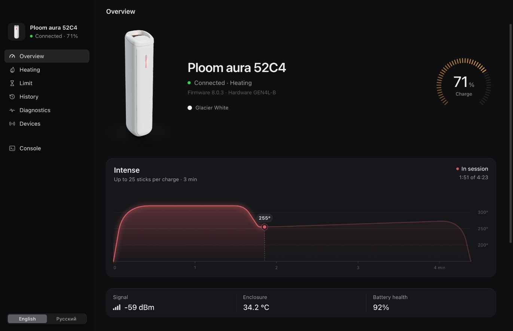
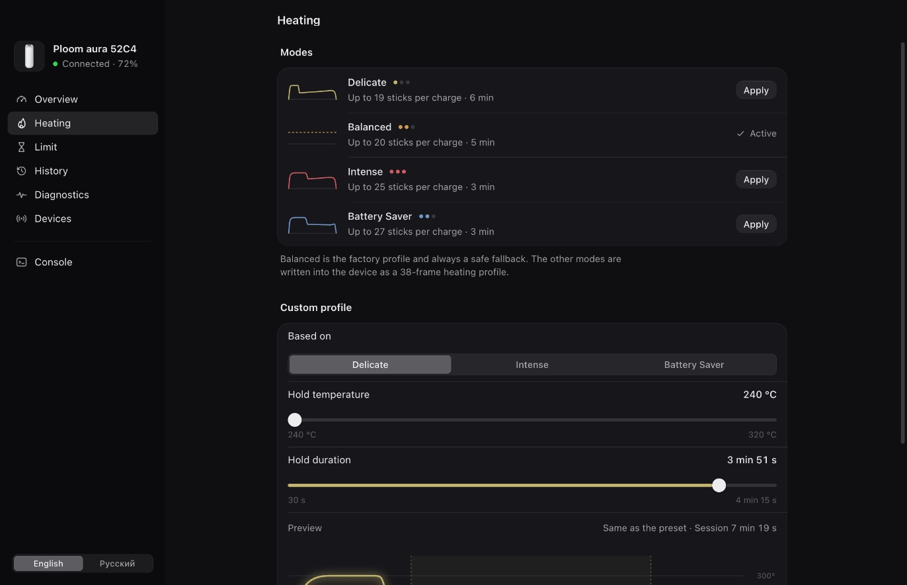
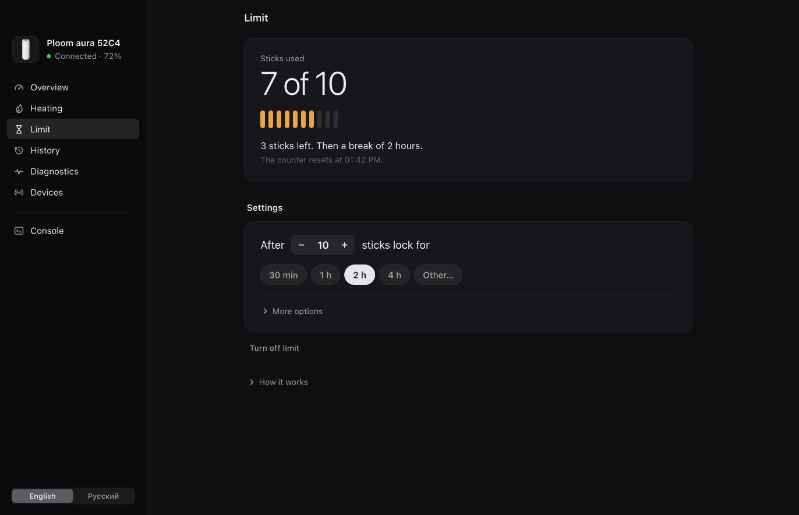
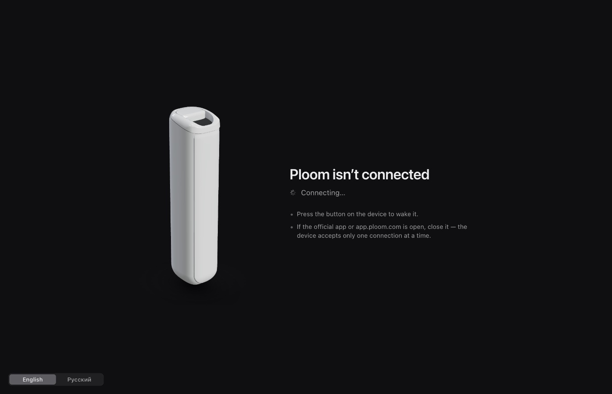

<div align="center">

# Ploom

**The desktop app the Ploom Aura never got: live status, your own heating
profiles, a stick limit — and the device on screen in its real colour.**

[](https://github.com/buttovvskiii/ploom-rs/actions/workflows/ci.yml)
[](https://github.com/buttovvskiii/ploom-rs/releases)
[](#license)

**English** · [Русский](README.ru.md)



</div>

An unofficial controller for the **Ploom Aura** heated-tobacco device over
Bluetooth LE, written in Rust: a desktop app, a command-line tool, and a
documented implementation of the device's protocol. No account, no cloud, no
telemetry — the app talks to the device and to nothing else.

> Not affiliated with, endorsed by or supported by JTI or Ploom. See the
> [disclaimer](#disclaimer).

| Heating | Stick limit | Connect |
|---|---|---|
|  |  |  |

## What you get

- **Everything the device knows, live.** Battery and battery health, charging,
  signal, enclosure temperature, lock state — and the session in progress,
  drawn as a playhead moving along the mode's heating curve.
- **Heating modes and your own profile.** Switch between Delicate, Balanced,
  Intense and Battery Saver with each curve shown up front, or start from a
  preset and set your own hold temperature (240–320 °C) and length (30–255 s).
  The exact frames are previewed before anything is written.
- **Your device, in its colour.** The app reads the body colour from the
  device itself and shows an interactive 3D Aura in that finish. It glows
  while heating, breathes green while charging, and can be turned around.
- **A stick limit.** After a number of sticks you choose, the device locks
  for a break you choose and unlocks when it ends. Honest about
  [what it can and cannot enforce](#stick-limit).
- **What the official app hides.** Session and charge logs read without
  deleting them, hidden sensors, lifetime statistics.
- **A raw console with safeguards.** Send any frame and see the decoded
  reply; destructive opcodes need an explicit confirmation.
- **A CLI.** `ploom` for scripts and automation, with JSON output.
- English and Russian, automatic reconnection, a native macOS look.

## Download

Get the latest build from [Releases](https://github.com/buttovvskiii/ploom-rs/releases):

| File | Platform |
|---|---|
| `Ploom-macos-universal.dmg` | macOS 11+, Apple silicon and Intel |
| `Ploom-windows-x64-setup.exe` | Windows 10/11, per-user install |
| `Ploom-linux-x64.AppImage`, `Ploom-linux-x64.deb` | Linux x64 (needs BlueZ) |
| `ploom-cli-*` | the `ploom` command-line tool for each platform |

The builds are not code-signed, so the system asks once:

- **macOS** — right-click the app → *Open* → *Open*. Or, in a terminal:
  `xattr -dr com.apple.quarantine /Applications/Ploom.app`.
- **Windows** — SmartScreen: *More info* → *Run anyway*. The installer fetches
  WebView2 if it is missing.

`SHA256SUMS.txt` in each release lists the checksums.

On first launch the system asks for Bluetooth access. The app opens on a
connect screen and looks for a Ploom Aura; press the button on the device to
wake it. The device accepts one connection at a time, so close the official
app and the app.ploom.com tab first.

### Platform support

| Platform | Status |
|---|---|
| macOS | Primary platform; developed here |
| Windows | Built by CI; not yet tested on hardware — reports welcome |
| Linux | Built by CI; not yet tested on hardware — reports welcome |

## Stick limit

A self-control aid the official app does not have. Choose a number of sticks
(1–40) and a break (5 minutes to 24 hours). When the limit is reached the app
waits for the session to end, locks the device, and unlocks it when the break
is over. The counter resets by itself after a window (24 hours by default) if
the limit was not reached.

- Sticks are counted as sessions start while the app is connected. Sticks
  used in between are added on reconnect from the device's lifetime counters.
- During a break the app will not unlock the device, and the limit can only
  be made stricter. If something else unlocks it, the app locks it again.
- The break is stored on disk: it survives a restart, and one that ended
  while the device was away is lifted on the next connection.
- A lock you set yourself is never lifted by the limit.

What it cannot do: the protocol has no pairing or authentication. While this
app is connected it holds the device's only connection, but when it is not,
the official app can unlock the device. The limit works for someone who wants
it to work; it is not a safe.

The limit is enforced by whatever holds the session: the desktop app, or
`ploom watch`. `ploom limit` uses the CLI's own data directory; pass
`--data-dir` to share the desktop app's.

## CLI

```console
$ ploom scan                      # nearby devices, without connecting
$ ploom status                    # full status (add --json for scripts)
$ ploom watch                     # every frame and event until Ctrl-C
$ ploom buzz 5                    # find the device: vibrate for 5 s
$ ploom lock | unlock
$ ploom autostart on|off
$ ploom mode                      # current heating mode
$ ploom mode intense --dry        # print the 38 frames, send nothing
$ ploom mode balanced             # restore the factory profile
$ ploom custom --base intense --temp 290 --secs 150
$ ploom limit --sticks 10 --cooldown 120
$ ploom logs                      # oldest logs, never deleted
$ ploom diag                      # hidden sensors and lifetime statistics
$ ploom raw 02e300                # dangerous opcodes need --force
```

Global options: `--device <ID>` (from `ploom scan`; default: the first Ploom
found), `--json`, `--data-dir <DIR>` (or `PLOOM_DATA_DIR`). Logging goes to
stderr and follows `RUST_LOG`, for example `RUST_LOG=ploom_core=debug`.

## How it works

```
crates/ploom-protocol   Pure protocol: framing, decoding, status merge, profile
        ▲               upload, colour codes. No I/O. Golden-tested byte for byte.
        │
crates/ploom-core       Bluetooth LE transport (btleplug) and the device session:
        ▲               connect, poll, reconnect, commands, limit, snapshots.
        │
        ├── crates/ploom-cli    `ploom` command-line tool
        │
        └── app/src-tauri       Tauri 2 desktop shell: IPC commands and events
                 ▲
                 │ IPC (contract: app/ui/src/lib/api/types.ts)
                 ▼
            app/ui              Svelte 5 + TypeScript UI, three.js device model
```

The device speaks a small request/indication protocol over one GATT service.
It was reverse-engineered and is documented in
[docs/PROTOCOL.md](docs/PROTOCOL.md); the design of the code is described in
[docs/ARCHITECTURE.md](docs/ARCHITECTURE.md).

The body colour is not a status field: the app decodes a three-character code
from the device's hardware-revision string and looks it up in a small table
(`crates/ploom-protocol/src/color.rs`). If your device shows up as an unknown
code, a pull request adding it is welcome.

## Build from source

Requirements: Rust stable (1.90+ for the desktop app, 1.85+ for the
libraries), Node.js 22 and pnpm 10.

- **macOS**: Xcode Command Line Tools.
- **Windows**: the MSVC build tools and WebView2 (preinstalled on Windows 11).
- **Linux**: `libdbus-1-dev`, `pkg-config`, and the
  [Tauri prerequisites](https://v2.tauri.app/start/prerequisites/#linux).

```sh
git clone https://github.com/buttovvskiii/ploom-rs.git
cd ploom-rs/app/ui
pnpm install
pnpm tauri build            # → target/release/bundle/
pnpm tauri dev              # run from source; connects to a real device
```

The CLI alone: `cargo install --path crates/ploom-cli`. On macOS the terminal
needs Bluetooth permission (System Settings → Privacy & Security → Bluetooth).

See [CONTRIBUTING.md](CONTRIBUTING.md) for the checks to run before a pull
request.

### Custom 3D model

The device on screen is a procedural model. To use your own, drop a
`ploom.glb` (glTF binary, Y-up, PBR materials, ideally under 5 MB) into
`app/ui/public/models/` before building; it is picked up automatically. See
[`app/ui/public/models/README.md`](app/ui/public/models/README.md).

## Safety

- **Changing the heating mode writes a heating profile into the device.**
  Every mode except Balanced, and every custom profile, is a 38-frame upload
  computed from the device's own calibration table. The app previews the
  frames, verifies the result with the device, and refuses calibration data
  it does not understand.
- **Balanced restores the factory profile.** One command, always available as
  a fallback.
- **The app never deletes device logs.** The delete command (`0xC4`), the
  Bluetooth-off command (`0xA1`) and firmware-update mode (`0xFF`) are refused
  unless you confirm them in the console or pass `--force` to `ploom raw`.
- **The protocol has no pairing or authentication.** Anyone within Bluetooth
  range can connect to a Ploom Aura that is not already connected. Only
  control your own device.

## Disclaimer

This is an independent, unofficial project. It is not affiliated with,
endorsed by or supported by JTI (Japan Tobacco International) or Ploom.
"Ploom", "Ploom Aura" and related names are trademarks of their respective
owners and are used here only to describe compatibility.

The protocol was reverse-engineered. Using this software may void your
warranty or put the device in an unexpected state. It is provided "as is",
without warranty of any kind; use it at your own risk.

This software does not encourage tobacco use. Heated tobacco products are not
risk-free.

## License

Licensed under either of

- Apache License, Version 2.0 ([LICENSE-APACHE](LICENSE-APACHE))
- MIT license ([LICENSE-MIT](LICENSE-MIT))

at your option.

Unless you explicitly state otherwise, any contribution intentionally
submitted for inclusion in the work by you, as defined in the Apache-2.0
license, shall be dual licensed as above, without any additional terms or
conditions.
