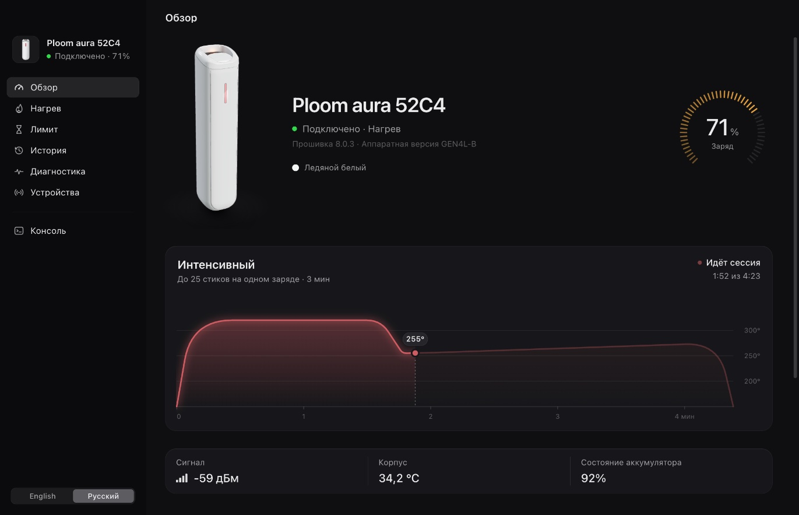
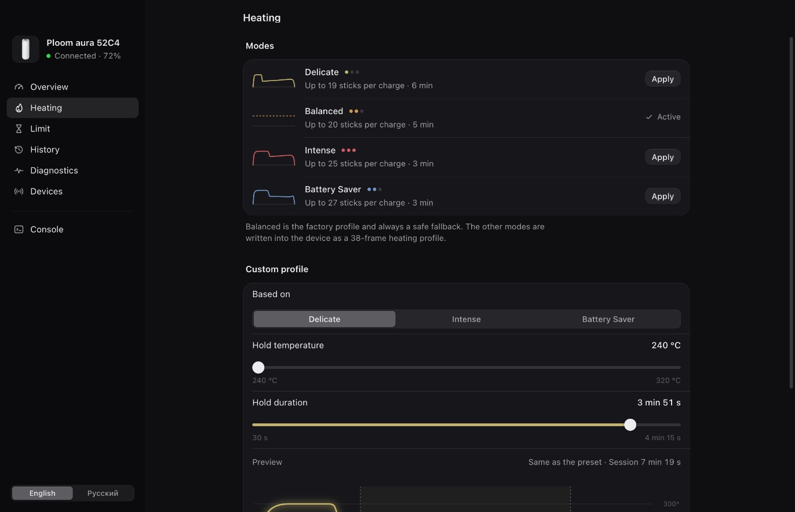
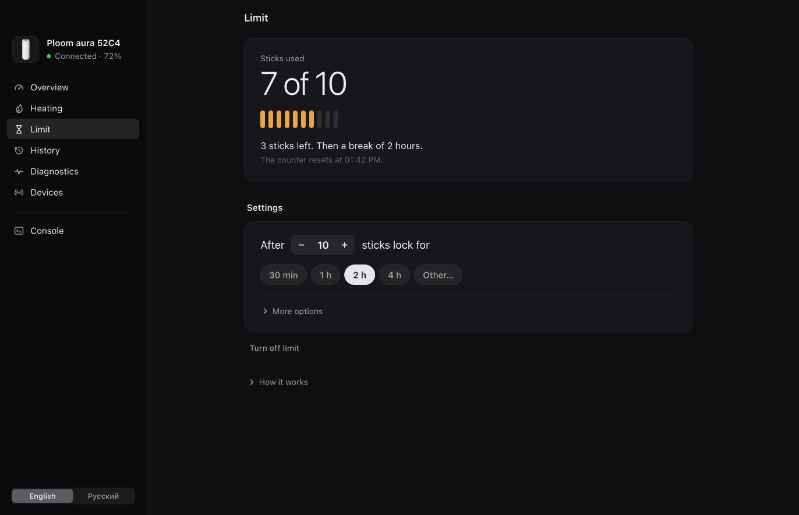
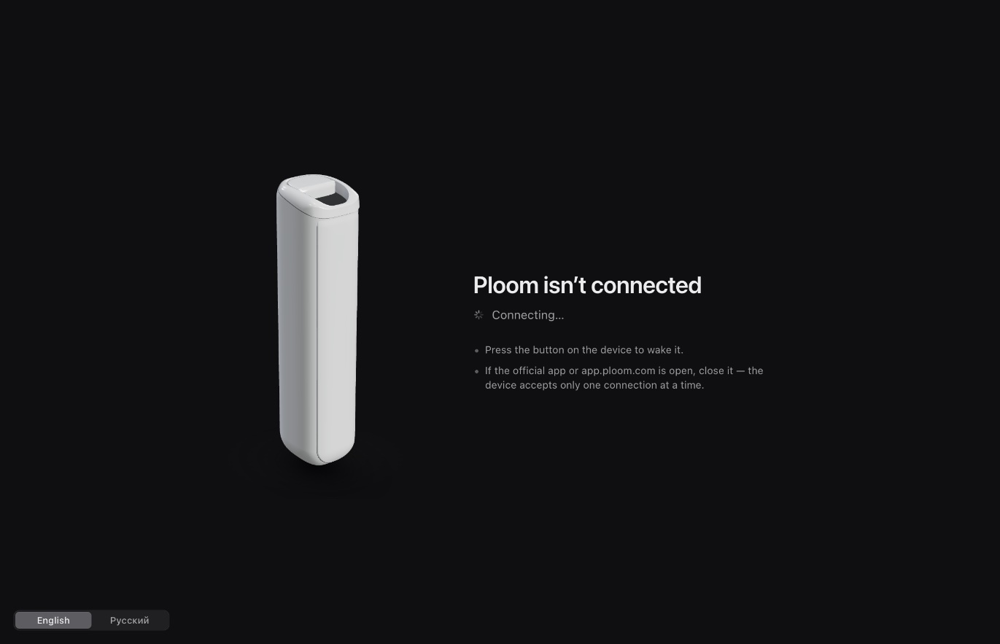

<div align="center">

# Ploom

**Настольное приложение, которого у Ploom Aura не было: состояние в реальном
времени, свои профили нагрева, лимит стиков — и само устройство на экране в
своём настоящем цвете.**

[](https://github.com/buttovvskiii/ploom-rs/actions/workflows/ci.yml)
[](https://github.com/buttovvskiii/ploom-rs/releases)
[](#лицензия)

[English](README.md) · **Русский**



</div>

Неофициальная программа для управления системой нагревания табака
**Ploom Aura** по Bluetooth LE, написанная на Rust: настольное приложение,
утилита командной строки и документированная реализация протокола
устройства. Без аккаунта, без облака, без телеметрии — приложение общается
только с устройством.

> Проект не связан с JTI и Ploom и не одобрен ими. См. [отказ от
> ответственности](#отказ-от-ответственности).

| Нагрев | Лимит стиков | Подключение |
|---|---|---|
|  |  |  |

## Что вы получаете

- **Всё, что знает устройство, — в реальном времени.** Заряд и износ
  аккумулятора, зарядка, сигнал, температура корпуса, блокировка. Идущая
  сессия показана отметкой, которая движется по кривой нагрева режима.
- **Режимы нагрева и свой профиль.** Delicate, Balanced, Intense и Battery
  Saver с кривой каждого режима перед глазами. Или возьмите пресет за основу
  и задайте свою температуру (240–320 °C) и длительность (30–255 с)
  удержания. Перед записью видны точные кадры, которые уйдут в устройство.
- **Ваше устройство в своём цвете.** Приложение читает цвет корпуса с самого
  устройства и показывает интерактивную 3D-модель Aura в этой отделке. Она
  светится при нагреве, «дышит» зелёным при зарядке, её можно повернуть.
- **Лимит стиков.** После выбранного числа стиков устройство блокируется на
  выбранный перерыв и разблокируется, когда он закончится. О том, [что лимит
  может и чего не может](#лимит-стиков), сказано честно.
- **То, что официальное приложение прячет.** Логи сессий и зарядок, которые
  читаются без удаления, скрытые датчики, статистика за всё время работы.
- **Консоль с защитой.** Можно отправить любой кадр и увидеть расшифрованный
  ответ; опасные коды операций требуют явного подтверждения.
- **CLI.** Утилита `ploom` для скриптов и автоматизации, с выводом в JSON.
- Русский и английский интерфейс, автоматическое переподключение, нативный
  вид в macOS.

## Скачать

Свежая сборка лежит в [релизах](https://github.com/buttovvskiii/ploom-rs/releases):

| Файл | Платформа |
|---|---|
| `Ploom-macos-universal.dmg` | macOS 11+, Apple silicon и Intel |
| `Ploom-windows-x64-setup.exe` | Windows 10/11, установка для текущего пользователя |
| `Ploom-linux-x64.AppImage`, `Ploom-linux-x64.deb` | Linux x64 (нужен BlueZ) |
| `ploom-cli-*` | утилита командной строки `ploom` для каждой системы |

Сборки не подписаны, поэтому система один раз переспросит:

- **macOS** — правый клик по приложению → «Открыть» → «Открыть». Или в
  терминале: `xattr -dr com.apple.quarantine /Applications/Ploom.app`.
- **Windows** — в окне SmartScreen: «Подробнее» → «Выполнить в любом случае».
  Установщик сам скачает WebView2, если его нет.

Контрольные суммы — в файле `SHA256SUMS.txt` каждого релиза.

При первом запуске система спросит доступ к Bluetooth. Приложение
открывается на экране подключения и ищет Ploom Aura; нажмите кнопку на
устройстве, чтобы его разбудить. Устройство принимает только одно
подключение, поэтому сначала закройте официальное приложение и вкладку
app.ploom.com.

### Поддержка платформ

| Платформа | Состояние |
|---|---|
| macOS | Основная платформа, разработка идёт на ней |
| Windows | Собирается в CI; на реальном устройстве ещё не проверялось — отчёты приветствуются |
| Linux | Собирается в CI; на реальном устройстве ещё не проверялось — отчёты приветствуются |

## Лимит стиков

Помощь в самоконтроле, которой нет в официальном приложении. Вы задаёте число
стиков (1–40) и длину перерыва (от 5 минут до 24 часов). Когда лимит
достигнут, приложение ждёт конца сессии, блокирует устройство и снимает
блокировку, когда перерыв закончится. Если лимит не достигнут, счётчик сам
сбрасывается через заданное окно (по умолчанию 24 часа).

- Стики считаются по началу сессий, пока приложение подключено. Стики,
  выкуренные без связи, добавляются при подключении по счётчикам самого
  устройства.
- Во время перерыва приложение не разблокирует устройство, а лимит можно
  только ужесточить. Если блокировку снимет что-то другое, приложение вернёт
  её.
- Перерыв хранится на диске: он переживает перезапуск, а перерыв, который
  закончился без связи с устройством, снимается при следующем подключении.
- Блокировку, которую вы включили сами, лимит не снимает.

Чего он не может: в протоколе нет ни сопряжения, ни аутентификации. Пока
приложение подключено, оно держит единственное соединение с устройством, но
когда оно не подключено, официальное приложение может снять блокировку.
Лимит работает для того, кто хочет, чтобы он работал; это не сейф.

Лимит исполняет тот, кто держит сессию: настольное приложение или
`ploom watch`. `ploom limit` работает с каталогом данных самого CLI; чтобы
использовать настройки настольного приложения, укажите `--data-dir`.

## CLI

```console
$ ploom scan                      # устройства поблизости, без подключения
$ ploom status                    # полное состояние (для скриптов — --json)
$ ploom watch                     # все кадры и события до Ctrl-C
$ ploom buzz 5                    # найти устройство: вибрация 5 с
$ ploom lock | unlock
$ ploom autostart on|off
$ ploom mode                      # текущий режим нагрева
$ ploom mode intense --dry        # показать 38 кадров, ничего не отправляя
$ ploom mode balanced             # вернуть заводской профиль
$ ploom custom --base intense --temp 290 --secs 150
$ ploom limit --sticks 10 --cooldown 120
$ ploom logs                      # самые старые логи, без удаления
$ ploom diag                      # скрытые датчики и статистика
$ ploom raw 02e300                # для опасных кодов нужен --force
```

Общие параметры: `--device <ID>` (из `ploom scan`; по умолчанию — первый
найденный Ploom), `--json`, `--data-dir <DIR>` (или `PLOOM_DATA_DIR`). Журнал
пишется в stderr и настраивается через `RUST_LOG`, например
`RUST_LOG=ploom_core=debug`.

## Как это устроено

```
crates/ploom-protocol   Чистый протокол: кадры, разбор ответов, слияние статуса,
        ▲               загрузка профиля, коды цветов. Без ввода-вывода.
        │               Сверен побайтно с эталонными векторами.
crates/ploom-core       Транспорт Bluetooth LE (btleplug) и сессия устройства:
        ▲               подключение, опрос, переподключение, команды, лимит.
        │
        ├── crates/ploom-cli    утилита командной строки `ploom`
        │
        └── app/src-tauri       оболочка на Tauri 2: IPC-команды и события
                 ▲
                 │ IPC (контракт: app/ui/src/lib/api/types.ts)
                 ▼
            app/ui              интерфейс на Svelte 5 + TypeScript,
                                модель устройства на three.js
```

Устройство общается по простому протоколу «запрос — индикация» через один
GATT-сервис. Протокол восстановлен обратной разработкой и описан в
[docs/PROTOCOL.md](docs/PROTOCOL.md) (на английском), устройство кода — в
[docs/ARCHITECTURE.md](docs/ARCHITECTURE.md).

Цвет корпуса — не поле статуса: приложение достаёт трёхсимвольный код из
строки аппаратной ревизии устройства и ищет его в небольшой таблице
(`crates/ploom-protocol/src/color.rs`). Если ваше устройство определилось
как неизвестный код, пул-реквест с ним будет кстати.

## Сборка из исходников

Понадобятся Rust stable (для приложения — 1.90 или новее, библиотекам хватает
1.85), Node.js 22 и pnpm 10.

- **macOS**: Xcode Command Line Tools.
- **Windows**: инструменты сборки MSVC и WebView2 (в Windows 11 уже есть).
- **Linux**: `libdbus-1-dev`, `pkg-config` и
  [зависимости Tauri](https://v2.tauri.app/start/prerequisites/#linux).

```sh
git clone https://github.com/buttovvskiii/ploom-rs.git
cd ploom-rs/app/ui
pnpm install
pnpm tauri build            # → target/release/bundle/
pnpm tauri dev              # запуск из исходников; подключается к настоящему устройству
```

Только CLI: `cargo install --path crates/ploom-cli`. В macOS терминалу нужен
доступ к Bluetooth (Системные настройки → Конфиденциальность и безопасность →
Bluetooth).

Какие проверки прогнать перед пул-реквестом, написано в
[CONTRIBUTING.md](CONTRIBUTING.md).

### Своя 3D-модель

Устройство на экране — процедурная модель. Чтобы использовать свою, перед
сборкой положите файл `ploom.glb` (glTF binary, ось Y вверх, PBR-материалы,
желательно до 5 МБ) в `app/ui/public/models/` — он подхватится автоматически.
Подробности в
[`app/ui/public/models/README.md`](app/ui/public/models/README.md).

## Безопасность

- **Смена режима нагрева записывает в устройство профиль нагрева.** Любой
  режим, кроме Balanced, и любой свой профиль — это 38 кадров, рассчитанных
  по калибровочной таблице самого устройства. Приложение показывает кадры
  заранее, сверяет результат с устройством и отказывается работать с
  калибровкой, которую не понимает.
- **Balanced возвращает заводской профиль.** Одна команда, доступная всегда.
- **Приложение никогда не удаляет логи устройства.** Команда удаления
  (`0xC4`), отключение Bluetooth (`0xA1`) и режим обновления прошивки (`0xFF`)
  выполняются только после явного подтверждения в консоли или с флагом
  `--force` у `ploom raw`.
- **В протоколе нет сопряжения и аутентификации.** Подключиться к Ploom Aura,
  у которого нет активного соединения, может любой в радиусе Bluetooth.
  Управляйте только своим устройством.

## Отказ от ответственности

Это независимый неофициальный проект. Он не связан с JTI (Japan Tobacco
International) и Ploom, не одобрен и не поддерживается ими. «Ploom», «Ploom
Aura» и связанные названия — товарные знаки их владельцев; здесь они
используются только для указания совместимости.

Протокол восстановлен методом обратной разработки. Использование программы
может лишить вас гарантии или привести устройство в неожиданное состояние.
Программа поставляется «как есть», без каких-либо гарантий; вы используете
её на свой страх и риск.

Проект не призывает к употреблению табака. Табачные изделия для нагревания
не безвредны.

## Лицензия

На ваш выбор:

- Apache License, Version 2.0 ([LICENSE-APACHE](LICENSE-APACHE))
- лицензия MIT ([LICENSE-MIT](LICENSE-MIT))

Если вы явно не указали иное, любой вклад, намеренно предложенный вами для
включения в проект (в смысле лицензии Apache-2.0), распространяется на тех
же двух лицензиях без каких-либо дополнительных условий.
